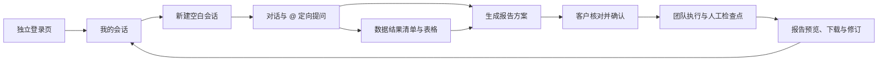
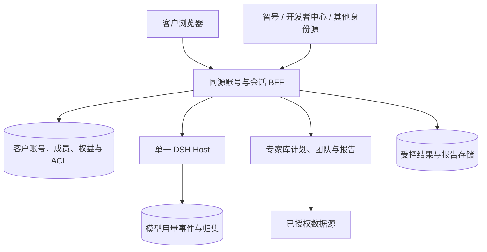

# 专家协作室：客户自助研究与报告需求设计

版本：整合评审稿 v1.0 · 2026-10-08  
范围：专家库独立页面、客户登录与账号、会话、定向查询、报告交付、用量和管理员界面。本文是产品与技术设计，不代表线上功能已实现或授权部署。v0.9 留档于 [旧评审稿](ACCOUNT-AND-NEW-SESSION-PRD-v0.9-20261008.md)。

## 1. 产品目标和首版边界

**目标旅程：客户使用独立登录页进入 → 新建会话并对话 → 查询并留存数据 → 确认报告方案 → 生成、预览、下载报告 → 日后找回会话、数据、报告与用量。** 客户完成这条旅程不需要粘贴旧分享链接，也不需要管理员为每次研究手工创建 DSH 会话或团队。

顶部主视图顺序固定为**会话 → 工作区 → 数据**。“研究成果”保留为工作区内的子页，承载报告成稿和版本。另设独立管理员界面，用于客户账号、权益、额度与用量管理。

首版技术形态：**一个 DSH 运行实例及租户，多客户账号分别绑定工作区**；浏览器经同源 BFF 访问 Host 和专家库。客户账号之间的 ACL、文件、工具与数据源隔离必须通过验收；若共用进程无法证明强隔离，对外开放前切换到按账号隔离的进程或容器。首批可用一个已验证的登录源、一个可验证的数据通道和一个报告模板做端到端试点，之后接入其余约定的身份源、领域包、专家与模板；这仅是实施批次，不删总需求。

### 1.1 名词与角色

| 名词 | 含义 |
|---|---|
| 客户账号 `account_id` | 工作区、研究会话、报告、额度和用量的归属主体；个人客户也拥有一个客户账号 |
| 登录用户 `user_id` | 经智号、开发者中心或其他受信身份源登录的自然人；一个人可经验证后绑定多个登录身份 |
| 成员关系 | 用户在客户账号内的角色。首批默认一账号一成员；数据结构支持后续一家机构多位员工 |
| 根会话 `captain_session_id` | 一次客户研究的主线，关联准备沟通、数据结果、计划、专家团队、报告和 token 用量 |
| 工作区 | 每客户账号绑定的 DSH 资源空间；同时页面“工作区”是计划、团队进度和成果视图，二者含义须在代码与文案中区分 |

客户账号拥有者可创建研究、选择材料、确认计划/大纲/正文、管理本账号成员与报告分享；协作者按授予能力参与。平台账号管理员负责开通、停用、权益和额度；`usage_admin` 负责跨账号用量只读审计。单会话分享访客仅有授予的查看或操作能力，不能枚举账号会话或查看完整用量。

### 1.2 首版不混淆的边界

- “能登录”不自动等于有所有数据源、领域包、专家、模型或管理员权限；能力由客户账号权益和运行时可用性共同决定。
- 创建会话、自由聊天、查询数据、保存数据结果、纳入报告材料、确认计划、公开分享报告是不同动作；页面与后端分别记录。
- 报告默认私有。现有审阅分享码与旧会话仍兼容，但不能成为新账号的全部会话通行证。
- token 统计用于透明展示与额度控制；数据源 API 次数/费用单独统计。若将来按金额收费，另设价格、结算与对账规则。

## 2. 客户旅程总览

每一步都须有“成功、处理中、需补充、失败后可重试”的可见状态。用户离开页面、断线或换设备后，回到同一个根会话及其当前检查点；重复点击不得重复创建会话、团队或报告。

### 2.1 登录与首次进入

独立入口建议分为逻辑上的 `/login`（客户登录）、`/app`（我的研究）和旧 `/review` 分享入口；实际部署路径由同源反代统一。未登录用户看到身份源选择，而非以“粘贴分享码”作为主要登录方式。登录成功后服务端查 `identity_links` 和 `account_memberships`；已开通客户首次进入时幂等供给客户工作区，随后展示“我的会话”或空状态中的“新建会话”。若采用开放注册，则先建立权限最小的试用账号；是否开放注册属于待定业务决策。

智号是待接入的账号系统，OIDC 是一种联合登录协议，不是账号名。开发者中心按已设计的 OIDC 路径对接；智号与其他第三方须核实实际协议、稳定 `issuer + subject` 和生产回调。OIDC 使用授权码加 PKCE，后端验证签名、issuer、audience、state、nonce，再建立本域 HttpOnly/Secure/SameSite 会话。邮箱、手机号和显示名不能用于自动合并账号；绑定第二身份要求同时证明当前登录态与新身份。一个用户若被授权加入多个客户账号，页面显示账号选择器，每次请求都由服务端核对当前账号成员资格。DSH 原登录可用于历史归属验证，不能把其 Cookie 直接当客户身份。

**验收**：新客户无旧链接也能登录并发出第一问；两种已绑定身份进入同一客户账号；未绑定的同邮箱身份看不到旧会话；重复回调或刷新不会建出多个工作区。

### 2.2 我的会话与新建

“我的会话”来自服务端，按客户账号与成员/会话 ACL 过滤，跨设备一致。列表显示标题、准备中/待确认/运行中/已完成/失败暂停/归档状态、最近活动、报告状态及累计 token；支持搜索、分页和状态筛选。分享给我的单会话单列，不自动变成本账号资产。打开列表不唤醒冷会话或调用模型。

点击“新建会话”在当前客户账号工作区幂等创建**空白 captain**，绑定 `account_id`、`created_by_user_id` 和工作区；默认仅本账号被授权成员可见。新会话从头开始，不复制旧聊天、数据源授权、团队或任务。创建本身不运行模型；进入首位的“会话” tab 后，客户发送第一条消息才开始沟通。旧成果可由有权用户显式引用为新材料，并记录来源。

**验收**：双击仅生成一个会话；空白会话能真实调用智见小秘书和允许的工具；新账号不能读取或引用其他账号的会话和材料。现有 `/review/api/action` 依赖 plan/team 的 scoped grant，空白会话消息需新增账号认证入口。

### 2.3 会话：先沟通，再决定是否做报告

会话允许先讨论议题、范围、受众、地域、时段、口径、交付形式，也允许单纯提问。智见小秘书的澄清题采用统一问题卡：**推荐选项逐行勾选，最后一行是自定义文本输入**，再显式提交。单选只取一项或自定义答案；多选可勾选多项并补充文本。问题卡可稍后回答，不阻断准备阶段自由聊天；正式计划、大纲和正文确认仍沿用 DSH `AskUserQuestion` 的版本、摘要与审批门，填写自定义文本不等于批准。

输入 `@` 打开可搜索的三组候选：**数据源、领域包、专家**。每项显示类型、名称、能力与可用状态；选中后插入包含 `type + id + version` 的结构化 token，手打同名文本没有授权效果。`@智见` 是用户指定的数据源展示示例，稳定 `source_id` 和底层 provider 必须在目录中核实，不按名称硬编码到政研通。

| 提及对象 | 会话中的作用 | 不会自动发生的事 |
|---|---|---|
| 数据源 | 在账号权益内调用已注册只读数据集，返回实际来源、指标、范围、单位、口径和状态 | 不自动纳入报告材料，不获得账号以外的数据权限 |
| 领域包 | 用已启用的包版本说明方法、场景和必问口径 | 不安装、升级或切换包，不代替正式计划审批 |
| 专家 | 请当前可用专家就具体问题回答，标明身份与模型 | 不自动加入报告团队，不启动研究任务 |

多个提及对象同处一条消息时明确各调用结果；不能判断主问题时先追问。每次调用须按账号权益、会话 ACL、对象可用性、版本、额度与审计记录校验；数据缺口径或通道失败时给出真实错误，不补造数字。

### 2.4 数据：会话查询后沉淀

会话查询成功并返回可表格化结果后，服务端在当前根会话下保存带版本的结果快照，聊天中显示摘要和“在数据中查看”。第三个“数据” tab **先展示查询结果清单**：标题、实际来源、指标/数据集、查询和数据截止时间、范围、行数、保存状态、材料选择状态。点击单项才进入只读表格，分页读取列名、单位、口径和数据行；支持返回清单与定位原对话。相同问题重查形成新结果，不覆盖旧快照。纯解释、领域包建议、专家意见留在会话，不伪装为表格。

自动留存与“纳入报告材料”独立。客户勾选后，计划绑定 `result_id`、哈希、版本和数据许可；取消勾选不删除历史结果。许可不允许留存、保存失败、快照过期或撤权时，清单显示状态，表格不可再读。清单和明细都逐次校验会话与数据许可，不能仅凭结果 ID 越权读取。

### 2.5 生成报告方案

“生成报告”是客户看得懂的主按钮，位于会话准备摘要与工作区显著位置。点击后客户选择可用的**报告模板/类型与交付格式**，系统整理已经确认的议题、问答、勾选数据、上传材料、受众、预算和交付要求，产生可编辑的方案：目标与边界、拟用专家和领域包、数据清单、初始大纲方向、任务步骤、预计 token/调用预算、质量检查与预计交付状态。页面标明推荐理由及缺失的必答信息；缺关键口径时继续追问，不直接开跑。

生成方案不等于启动团队。客户在工作区预览和修改后，服务端对专家可用性、模型、领域包与技能版本、数据许可、文件权限和额度做预检；客户确认特定方案版本后才应用计划。对 98wiki 等深度研究继续遵守现有路由专家、团队规模、候选大纲及正文人工门。正式报告任务继续显式绑定适用的报告工艺和 MD/HTML/PDF/证据产物要求，不用普通聊天答复代替成稿。

**验收**：从空白会话进入一个已验证模板，客户能看懂要用哪些数据与专家、预计消耗和需要确认什么；连续点击“确认”只启动一次团队；新方案修订不能静默改写已运行版本。

### 2.6 执行、报告交付与再次使用

工作区显示计划确认、团队启动、取证、候选大纲、正文评审、成稿的真实阶段与检查点；SSE 断线后从服务端状态恢复。需要客户决策时显示问题卡与待确认入口；失败时标明可重试、需改口径、额度耗尽或管理员处理的原因。额度达到上限后不启动新调用，单次请求的预留余量与超额处理在方案中说明。

报告成稿进入工作区“研究成果”，区分草稿、待确认与正式版本。客户可在账号权限内预览 HTML/PDF、下载正式文件，查看版本、生成时间、使用的数据与来源以及质量验收状态；修订产生新版本，旧版保持可追溯。默认仅账号内有权成员可读。账号外分享必须由有权成员显式创建限定对象、能力和期限的授权，并可撤销；旧审阅链接按原有单会话范围兼容。

客户以后从“我的会话”回到同一会话，继续对话、查看数据与报告、发起修订、读取 token 用量；原会话归档不删除已有成稿。报告下载、分享和修订均记录审计。

**验收**：首次登录客户可独立完成一份可预览和下载的报告；刷新、断线、换设备后能找回当前阶段和最终版本；未授权 URL、原始 Host API 或静态渲染路径不能读取他人的报告。

**常见异常的恢复**：身份源暂不可用时说明登录失败原因，已有本域会话按有效期与停用状态处理；身份绑定冲突进入人工核查，不自动合并。查询失败保留提问和错误回执，不生成伪表格。报告生成失败保留已确认方案和材料快照，重试同一作业或显式创建新版本；暂停/额度耗尽显示下一步动作。网页断线后重连原事件流并校验服务端状态，不重建研究。

## 3. 管理员旅程：开通、额度与用量

独立 `/admin` 界面分“客户账号”和“用量”两区。平台账号管理员可查看客户状态，按已批准策略开通、暂停、恢复账号，配置成员、可用身份源/数据源/领域包/专家/模板/模型、每账号及每会话额度与并发上限；客户账号拥有者仅管理自己账号内已授予的成员与报告分享。`usage_admin` 可只读查看跨账号 token，点击账号下钻会话，再下钻模型、阶段、请求时间和统计完整度；该角色不自动获得报告正文阅读权或账号改配权。

用户本人能在会话列表和详情查看本账号各会话自创建以来的累计 token、最近更新时间及分桶。管理员可按时间范围、账号、模型筛选；时间按模型请求完成时刻记录为 UTC，页面按选定时区显示。模型提供方报告的未缓存输入、缓存读取、缓存写入、输出分别展示；推理 token 是输出子集，不能重复相加。重试和失败但已计量的请求纳入统计，专家/团队子会话只归到根会话一次；协作者或分享访客触发的模型用量归到会话所属客户账号，并记录实际发起人或分享授权 ID。缺少可靠记录时展示已知用量及“部分统计/未知”，不把未知写成零。数据源 API 费用与模型 token 分列。

额度按后端可验证用量执行：启动请求前检查账号、会话、模型和数据源额度，预留单次请求余量；达到限制后暂停**新**模型或数据调用，并告知客户如何调整范围或申请额度。无法可靠计量且无法设置安全请求上限的模型路由，不向外部客户开放。管理员变更即时影响新调用、发送、审批和流式连接，并留审计。

## 4. 页面结构与主要状态

| 页面 | 客户看到的主要内容 | 关键动作 |
|---|---|---|
| 登录 `/login` | 智号、开发者中心及已开放身份源；错误与账号绑定指引 | 登录、绑定、退出 |
| 我的研究 `/app` | 服务端会话列表、状态、报告状态、累计 token、空状态 | 新建、搜索、继续、归档 |
| 会话（第一 tab） | 聊天、勾选加末行自定义的问题卡、三类 `@`、报告入口 | 提问、回答、查询、生成报告方案 |
| 工作区（第二 tab） | 准备摘要、计划、大纲、进展、研究成果及报告版本 | 核对、确认、预览、下载、修订、受控分享 |
| 数据（第三 tab） | 查询结果清单；点击后只读表格 | 查找、查看、纳入/移出报告材料 |
| 管理员 `/admin` | 客户账号、权益、额度、跨账号用量 | 开通/停用、调整额度、审计与下钻 |

会话主状态建议为 `preparing → plan_drafting → awaiting_plan → running → awaiting_outline → running → awaiting_body → report_ready`，另有 `paused / failed / archived`；正式确认保留 digest/revision/source SHA/CAS。报告版本另有 `draft → reviewing → approved → published`，失败可重试但不覆盖已批准版本。UI 始终取服务端真实状态，不用前端按钮点击推断“已完成”。

## 5. 技术设计：归属、数据与 API

### 5.1 服务与信任边界

账号服务决定客户/用户身份、工作区归属和 ACL；DSH Host 是会话与模型用量原始事件的权威；专家库是计划、团队、任务、报告质量与审批权威。BFF 不复制聊天正文；仅存服务端索引、准备记录、数据与报告引用、用量归集。客户浏览器不直接获得 Host 的全量会话列表或内部管理 API。

| 对象 | 关键字段与约束 |
|---|---|
| `accounts`、`users`、`identity_links` | 客户账号与登录人分离；`(issuer, subject)` 唯一；显示名/邮箱不可作为自动合并依据 |
| `account_memberships`、`account_workspaces`、`account_entitlements` | 成员角色与账号权益在服务端判定；一个首版客户账号绑定一个服务端供给的工作区 |
| `research_sessions`、`session_grants` | `account_id`、`workspace_id`、`captain_session_id`、创建人、状态与授权；分享只授单会话能力 |
| `research_preparations`、`mention_receipts` | 问题卡答案、选入材料及 typed `@` 路由版本；原对话留在 DSH |
| `data_query_receipts`、`data_results` | 源 ID、查询摘要、口径、快照哈希、保留期限、状态；表格明细留受控存储 |
| `report_jobs`、`report_versions` | 根会话、确认的计划版本、模板、材料哈希、阶段、MD/HTML/PDF/证据引用与质量回执；版本不可原地覆盖 |
| `usage_events`、`usage_rollups` | provider/model、阶段、尝试键、输入/缓存/输出桶、根会话与账号映射、覆盖状态；可重放对账 |
| `account_limits`、`audit_events` | token/查询/并发限制、变更人与生效时间；登录绑定、审批、下载、分享、额度变更均可追溯 |

### 5.2 BFF API 草案

| 范围 | 主要入口 | 授权重点 |
|---|---|---|
| 登录与账号 | `GET /api/me`、`GET /api/auth/{provider}/start`、`GET /api/auth/{provider}/callback`、`POST /api/logout`、`POST/DELETE /api/me/identities` | 身份源回调、双重验证、当前 `account_id` 成员资格 |
| 会话 | `GET/POST /api/research-sessions`、`GET /api/research-sessions/{id}`、`POST /api/research-sessions/{id}/messages`、`POST /api/research-sessions/{id}/answers`、`GET /api/research-sessions/{id}/events` | 创建幂等；账号、工作区、会话 ACL 每次重查；SSE 撤权生效 |
| 三类提及与数据 | `GET /api/mentionables`、`POST /api/research-sessions/{id}/data-queries`、`GET /api/research-sessions/{id}/data-results`、`GET /api/research-sessions/{id}/data-results/{resultId}/rows`、`POST /api/research-sessions/{id}/data-results/{resultId}/material-selection` | 账号权益、数据许可、只读能力、行级分页与快照版本 |
| 报告 | `POST /api/research-sessions/{id}/report-previews`、`POST /api/research-sessions/{id}/report-jobs`、`GET /api/research-sessions/{id}/report-jobs/{jobId}`、`POST /api/research-sessions/{id}/report-jobs/{jobId}/confirm`、`GET /api/research-sessions/{id}/reports/{versionId}/artifacts` | 预览不启动；确认带方案 digest；读取仅限账号 ACL；质量门与下载状态分离 |
| 报告分享 | `GET/POST /api/research-sessions/{id}/reports/{versionId}/shares`、`DELETE /api/research-sessions/{id}/reports/{versionId}/shares/{shareId}` | 显式发放、限时、可撤销；旧公开文件路径不得复用作新账号分享 |
| 用量与管理 | `GET /api/me/usage`、`GET /api/research-sessions/{id}/usage`、`GET /api/admin/accounts`、`GET /api/admin/usage/accounts`、`PATCH /api/admin/accounts/{accountId}` | 本人按账号读取；平台管理角色与 `usage_admin` 分权；所有跨账号操作审计 |

API 表示逻辑接口；是否沿用当前 `/plugins/dsh-expert-library/review/api/*` 由同源 BFF 路由实现决定。新建时预分配幂等键并处理 Host 创建成功而归属登记失败；报告任务、数据快照与用量事件也须可重放对账。`@` token 按类型与稳定 ID 解析，不接受浏览器传入的工作区路径、owner ID 或 provider 凭据作为授权依据。

### 5.3 必须通过的安全与可靠性门

1. 每个登录请求服务端验证 `user_id → account_membership → account_id → workspace_id → session_id`；原始 Host API、SSE、文件、工具运行和数据连接器均执行等效隔离。目录分开本身不足以证明隔离。
2. 当前独立页的 `/api/issue` 只按既有 captain/plan/team 定位且 `hostAuth` 只给通过/拒绝；新客户身份必须有可信 subject 与会话归属校验。不能让分享 Cookie 变成账号列表凭据。
3. 当前 `/api/document-share` 会把文件写到匿名 `/render/expert-library/...` 静态路径。新账号成稿的私有读取、临时分享、撤销及旧公开路径兼容需分开；未授权静态路径不得泄露新报告。
4. 登录回调、所有写请求、文件上传和报表导出实施同源/CSRF、限流、审计、上传扫描；敏感资料及 provider 凭据不得进入 URL、浏览器本地存储、报告正文或日志。
5. 数据与报告快照受来源许可、保留期限和撤权控制。模型用量来自 Host/provider 持久记录，重试与子会话按稳定键去重；不完整结果标记，不伪造精确账单。

## 6. 分批交付与验收

| 批次 | 交付 | 放行标准 |
|---|---|---|
| P0 技术闸门 | 当前运行版身份 subject、空白 captain 首问、工作区供给、工具与文件隔离、报告私有读取、用量来源的真实演练 | 从首次登录到首问可跑通；跨账号原始 API/文件/工具拒绝；明确单实例是否可对外 |
| P1 客户闭环试点 | 一个已验证身份源、单成员账号、我的会话、会话澄清、一个授权数据源、数据 tab、一个报告模板、预览/确认/执行/下载、账号额度与管理员基本视图 | 新客户无人工建会话，独立完成一份带来源的 HTML/PDF 报告；换设备找回；第二个账号看不到任何数据/报告 |
| P2 完整入口 | 智号、开发者中心及约定第三方的身份绑定；三类 `@`、更多领域包/专家/模板、多人成员与受控分享 | 同一人多身份落同一账号；各对象按权限路由；多人协作不改变原报告所有权 |
| P3 历史与运营 | 待认领迁移、旧分享兼容、用量回填、备份恢复、故障处理、审计与规模化隔离 | 无主/冲突会话不猜归属；旧链接按原范围可用；恢复后账号、会话、数据、报告及用量一致 |

端到端验收至少覆盖：①新客户登录并新建会话；②选择 `@智见` 查数，数据清单先于表格且可跨设备找回；③问题卡“勾选 + 最后一行自定义”及自由聊天；④生成方案但未经确认不启动团队；⑤预算耗尽不再发起新模型调用；⑥报告成稿可预览/下载且默认私有；⑦两个账号跨页面、原始 API、SSE、文件和工具均隔离；⑧管理员可看账号、额度和用量，普通账号不能越权；⑨重试、断线和重复点击不生成重复团队/报告；⑩历史待认领会话不错误归属。

## 7. 尚需业务定值的决策

| 决策 | 本稿建议的默认值 | 待确认内容 |
|---|---|---|
| 客户账号形态 | 数据结构支持机构多成员，首批按单成员账号开通 | 是否允许客户自行邀请员工；一个登录用户能否同时属于多个客户账号 |
| 首次开通方式 | 已开通/受邀客户首次登录自动供给工作区 | 是否对任何已认证用户开放试用注册，试用权益是什么 |
| 首批登录源 | 先验收一个生产可用源，全部约定身份源保留在完整范围 | 智号实际协议、开发者中心生产 issuer 与各自开通顺序 |
| 首批报告 | 选一个已有领域包、真实数据通道和质量门的报告模板，交付 HTML/PDF | 目标客户/议题、最长等待时间和允许修订次数 |
| 对外分享 | 报告默认私有，外发才创建可撤销限时授权 | 账号外收件人是否必须登录，以及最长有效期 |
| 额度与用量 | 账号与会话双层上限，provider 查询单列；分享访客调用记会话所属账号 | 初始额度、超额后的审批人，以及是否未来按金额结算 |

## 8. 部署与现有页面迁移

页面可独立部署在另一服务器，DSH 保持现有业务后端。推荐公开入口同源：反代把页面送新服务器，把 BFF/API/SSE 送受信后端；服务器间走私网或受限隧道，浏览器不直连 DSH 内部端口。当前 `review.js` 使用相对 API、`credentials: same-origin` 和同源 `EventSource`，后端还验证 Origin/Host；独立部署需迁移静态打包、Cookie/SSO、反代和 SSE 超时，不能只把 `localhost` 改为新域名。若采用全新域名，原 DSH Cookie 不会自动成为新站登录态，应按受信 SSO/BFF 重新建立身份。

旧分享入口、运行中研究与既有文档保持兼容；新客户页面按账号认证进入。上线先用测试入口验证登录、首次创建、会话、查询、报告、用量与跨账号隔离，再灰度切换；不直接改动运行中团队。
