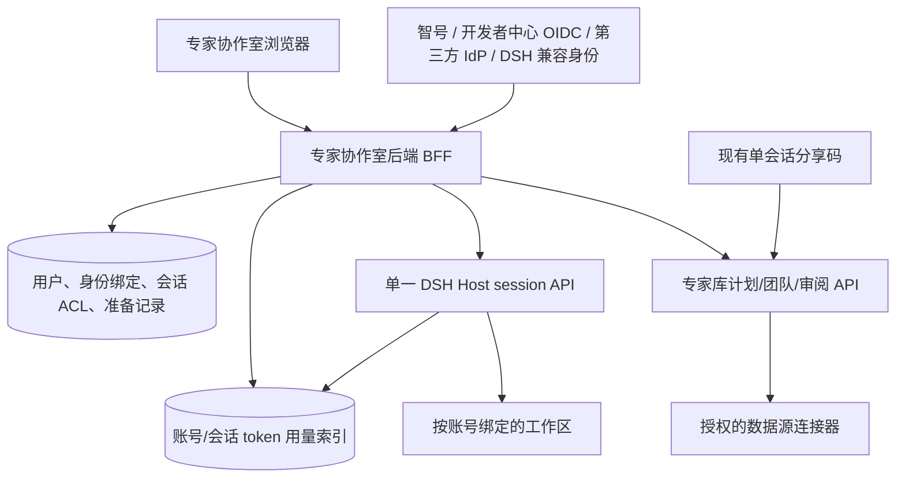
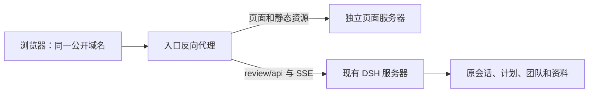

# 专家协作室：统一账号、新建研究会话与用量管理

版本：评审稿 v0.9 · 2026-10-08  
范围：`yy.meizu.life/plugins/dsh-expert-library/review` 独立页及其身份、会话、研究启动接口，另含用量统计接口和独立管理员界面。本文只定义需求和设计，不授权上线或改变正在运行的团队。

## 1. 一页结论

将独立页升级为用户的“研究工作台”：登录后跨设备看到**本人有权访问**的研究会话及各会话 token 消耗；点击“新建会话”立即进入空白会话，先和智见小秘书讨论议题、研究目标、数据源和材料，准备充分后再生成研究计划，经过明确确认后启动专家团队。顶部顺序为“会话 → 工作区 → 数据”；会话查出的表格数据沉淀在第三个 tab，先看查询结果清单，点击某条再打开表格。另设管理员界面按账号汇总和追溯用量。现有审阅分享链接继续承担单会话授权，不能因此变成“查看分享人全部会话”的凭据。

账号、会话与用量管理共享一个前提：平台需要稳定的内部 `user_id`、可验证的外部身份绑定，以及 `user_id → workspace_id → captain_session_id` 的服务端归属关系。首版只连接**一套 DSH 实例**，每个账号绑定自己的工作区。浏览器本地记录、URL 的 `captain`/`access` 参数和仅用于闸门的分享码都不能代替归属关系。

### 已核实的现状与影响

| 现状 | 证据 | 设计影响 |
|---|---|---|
| 独立页的授权是针对 captain/plan/team 的短期令牌和 HttpOnly Cookie | `src/host/review-access.ts`、`src/host/review-routes.ts` | 只保留为分享和兼容入口；账号入口另建服务端鉴权 |
| 左侧会话列表来自本浏览器 `localStorage`，最多保存 20 个曾打开的访问记录 | `assets/review/review.js` 中 `savedAccesses()` | 需替换为服务端分页列表；本地记录仅作旧链接提示 |
| 独立页已有聊天、计划编辑/确认、大纲选择、实时状态和结果阅读 | `src/host/review-routes.ts`、`src/host/review-conversation.ts` | 新建流程接入原有运行/审核链，避免另造研究引擎 |
| DSH Host 已提供 `session.list` / `session.create`，但插件当前没有账号归属索引和独立页创建入口 | 宿主 API 的 `sessions.d.ts`、插件 Host 路由 | 需要授权适配层；不能把 Host 全量列表直接给页面 |
| 本地 DSH 认证门使用用户名作为登录 subject；领域包开发者中心已有独立 OIDC 设计且不共享 DSH Cookie | `dsh-auth-gate` 的 `session-store.d.ts`、`PACK-CENTER-DESIGN.md` §4 | 用身份联邦与账号绑定，不能靠复制 Cookie 打通 |
| 98wiki 深度研究当前含计划确认、候选大纲人工选择、数据可得性探针等节点 | `src/deep-research-plan.ts` | 可在准备对话中表达“初始大纲/方向”，正式候选仍由团队生成并按现有门确认 |
| 本地 DSH 源码已有 `tokenUsage` 会话投影及完成轮次的 provider 用量归集；专家库独立页尚无按账号汇总接口 | DSH `packages/llm/token-meter/src/usage-projection.ts`、`turn-usage.ts`；本插件 `src/host/review-routes.ts` | 服务端读取/归集真实模型用量，补账号归属、团队子会话关联和管理员只读查询；上线前核对当前运行版本的接口 |

## 2. 产品目标、用户与边界

### 2.1 用户目标

1. 用户可以用“智号”、本地自建开发者中心或被批准的其他第三方账号登录；绑定后进入**同一个专家协作室账号**。DSH 现有登录用于历史会话归属核验和兼容，是否保留为正式入口另行确认。
2. 在手机或电脑登录后，能看到该账号名下的全部有权会话，按状态、时间、关键词查找并继续；新设备不需要逐个粘贴旧链接。
3. 用户可以先创建一个空白会话，自由沟通议题和问题，也可 `@` 数据源、领域包或专家定向提问；查得的表格数据自动沉淀到该会话的“数据” tab，方便跨设备回看；在会话里回答结构化澄清问题，再到工作区检查专家、方法、材料和计划，确认后启动团队。
4. 团队分享、组织协作与审计有明确角色：拥有者、受邀协作者、只读访客、管理员。第三方登录不会自动获得别人的历史会话。
5. 用户可以查看自己每次研究会话的 token 消耗；有用量管理权限的管理员可在独立界面按账号、会话和时间段查看消耗。

### 2.2 首版边界

- 首版固定一套 DSH 实例和一个运行时租户；多个登录账号分别绑定自己的 DSH 工作区。一个人绑定的多种登录方式共用同一 `user_id` 与工作区，不为每种登录方式重复建工作区。跨 DSH 实例汇总留作后续扩展。
- 登录本身不赠送数据源许可、开发者中心审核权或 DSH 管理权。这些权限分别核查。
- 点击“新建会话”即创建新的 DSH captain session，初始状态为“准备中”，没有计划和团队；原会话的上下文、分享授权、团队和任务不得复制。允许用户主动引用旧成果为新会话材料，需记录来源与授权。
- “全部会话”指**本账号拥有或被正式授予成员权限的会话**。单个分享码只展示其绑定的会话，不进入账号总列表。
- 用量统计覆盖通过专家协作室账号创建或已完成可信归属映射的会话；无法归属的历史会话先列为“待归属”，不猜测计入某账号。数据源 API 调用次数/费用与模型 token 分列，不混算为 token。
- 不在这一版自动迁移、合并、删除原有研究；准备中会话允许继续提问与保存选择，但不会自动生成计划或启动团队。

## 3. 需求 A：账号、联合登录与我的会话

### 3.1 登录入口与账号模型

页面右上角显示头像/账号菜单。未登录时展示“登录以查看我的研究”，可选择：

| 入口 | 首版处理 | 前提 |
|---|---|---|
| 智号账号 | 接入智号身份源；首次登录建立或绑定专家协作室账号 | 确认智号实际支持的联邦协议、稳定 subject、issuer 和回调规范；不预设它已支持 OIDC |
| 本地开发者中心账号 | 通过其 OIDC 身份源登录或与已有账号绑定 | 确认生产 issuer、client、回调域名和身份服务运营责任 |
| 其他第三方账号 | 采用逐家接入的 OIDC/OAuth 身份提供者 | 第三方名单、范围和合规要求经业务确认 |
| DSH 原有登录 | 用于历史归属验证；可按需要保留兼容登录 | 当前认证门能向后端提供已验证 subject；如不能，先增加后端验证接口 |

平台内部生成稳定、不可重用的 `user_id`。外部身份表以 `(issuer, subject)` 为唯一键指向 `user_id`。显示名、邮箱、手机号是可变资料，不作为自动合并依据；首次使用不同身份登录时，只有在**同时验证原账号登录态与新身份**后才可主动绑定。智号、开发者中心与 DSH 各自保管自己的会话 Cookie，专家协作室只建立自己的服务器会话。OIDC 是登录联邦协议，不是账号 ID 或具体账号系统。

对支持 OIDC 的身份源，建议使用授权码 + PKCE；后端完成代码交换和签名、issuer/audience/nonce 等验证，再签发仅本域使用的 HttpOnly、Secure、SameSite Cookie。智号若采用其他协议，须在确认其正式接口后设计对应适配。账号会话可撤销、可查看登录设备；高风险绑定与解绑要求重新验证。身份源暂不可用时已有会话是否继续有效须按过期时间和禁用状态判定，不能无限缓存授权。

### 3.2 我的会话

- 默认按最近活动排序，分“待我确认 / 研究中 / 已完成 / 已归档”；显示标题、议题、工作区、团队、最近进度和时间。支持搜索与分页；页面不因打开列表唤醒冷会话或启动模型。
- 顶部固定“新建会话”；会话卡默认进入“会话”，顶部视图顺序固定为“会话、工作区、数据”。工作区保留研究计划/大纲/团队进展/成果；数据 tab 保存该会话的查询结果清单，点击后再加载表格。深链接仍能直达某个计划、大纲、任务或数据结果。
- 服务端每次按登录 `user_id`、租户、会话 ACL 过滤。会话详情、对话、文档、SSE、发送和确认分别重查权限；前端隐藏按钮不能代替后端授权。
- 分享访问在侧栏单列“通过链接查看”，只展示当前分享授权覆盖的会话，不纳入“我的会话”。分享码兑换、失效、撤销保持现有语义；登录后打开分享链接也不会自动将该会话归我。
- 所有权归属由新建事务记录。已有历史会话采用“待认领”迁移：从现有可信 DSH 登录上下文或管理员签署的映射导入；冲突、无证据和多人共享记录保持待认领，禁止按标题/URL/邮箱猜归属。导入先出预览清单和冲突报告，再逐批生效。

### 3.3 权限矩阵

| 操作 | 拥有者 | 受邀协作者 | 单会话分享访客 | 平台管理员 |
|---|---|---|---|---|
| 我的会话列表与新建 | 自己的列表/可新建 | 授权的列表 | 无账号列表 | 仅管理视图，需审计 |
| 查看 token 用量 | 自己账号的会话用量 | 仅授权会话用量 | 不得凭分享码查看账号或完整用量 | 获授用量管理角色后可查看跨账号汇总与明细，需审计 |
| 阅读与对话 | 是 | 依授权 | 依分享范围和期限 | 按管理制度 |
| 改计划/确认大纲/启动 | 是 | 可单独授予“可决策” | 保留现有分享令牌可执行范围，后续收紧到显式能力 | 不自动代用户确认 |
| 邀请、撤权、归档 | 是 | 否 | 否 | 仅受控操作 |

默认新会话仅拥有者可见。邀请与分享分别记录授予者、对象、权限、期限和撤销时间；关键决定记录真实 `user_id` 或明确的 `share_grant_id`，不把“令牌使用者”伪装成已登录人。

### 3.4 身份异常和账号恢复

- 同一身份已绑定其他用户：拒绝绑定，进入人工核查；不静默合并会话。
- 外部身份取消授权：停止新登录；既有专家协作室会话按安全策略过期/撤销。已绑定的其他身份可继续登录。
- 账号停用：立即撤销平台会话、成员授权和新建/发送权限；原研究资料保留，处理人可按制度重新分配。
- 开发者中心身份与专家协作室账号解绑：保证至少一个可登录方式，保留审计，不改变研究所有权。
- 原 DSH 用户名改名或迁移：依稳定 subject/受信映射处理；单凭同名不自动认领。

### 3.5 用户用量与管理员界面

- “我的会话”列表显示每次会话自创建以来的累计 token；进入会话后，在固定位置看到本会话的累计值和最近更新时刻，展开可看未缓存输入、缓存读取、缓存写入、输出及模型/阶段明细。准备沟通、`@专家` 咨询、计划生成和团队执行产生的模型调用均计入同一根 captain 会话；子会话只在其对应根会话汇总一次。
- 单独提供 `/admin/usage`“用量管理”界面，仅具备平台用量管理角色的账号可进入。默认展示所选时间段的总 token、账号数及按账号排序的消耗清单；点击账号查看该账号各会话，点击会话查看模型、阶段和时间明细。时间段按模型请求完成时间统计，后端统一用 UTC 记录，页面按选择的时区显示；支持时间范围、账号、模型筛选与分页。角色权限由服务端校验，普通用户不能通过改 URL 请求其他账号。
- 口径以模型提供方报告的实际请求用量为准：未缓存输入、缓存读取、缓存写入、输出分别展示；推理 token 若有，是输出的一部分，不能再加一次。重试、失败但已计量的模型请求也要计入；正在运行的会话显示“更新中”。某些调用缺少可靠用量时，显示“部分统计/未知”及覆盖范围，不把缺失值写成零或宣称精确总量。
- 账号归属以研究会话的服务端 owner/workspace 映射为准，另外记录发起人以便审计协作者操作。分享访客产生的用量记在会话所属账号下并保留实际发起人或分享授权 ID；历史待认领会话在确认归属前单列，不混入某个账号。用量仅用于展示与运营核对；若将来用于扣费或配额，另设可审计的价格、计费和对账规则。

```text
用量管理（仅管理员）  时间范围 [近 30 天 ▾]  账号搜索 [____]
账号清单：账号名 | 已知 token | 统计完整度 | 会话数
点击账号 → 会话清单：会话标题 | token | 最近更新
点击会话 → 未缓存输入 / 缓存读 / 缓存写 / 输出 / 模型与阶段明细
```

## 4. 需求 B：从零新建研究会话

### 4.1 用户流程

```mermaid
flowchart LR
  A[我的会话] --> B[新建空白 captain 会话]
  B --> C[会话：自由沟通与选项澄清]
  C --> D[可选：@数据源 / 领域包 / 专家]
  D --> C
  C --> E[生成研究方案]
  E --> F[工作区：核对数据、专家、计划]
  F --> G[人工确认并启动团队]
  G --> H[候选大纲确认]
  H --> I[取证、正文确认与交付]
```

**步骤 1 · 新建并先进入会话。** 点击“新建会话”即在当前账号工作区创建一条空白 captain session，幂等返回会话 ID，打开排在首位的“会话” tab。页面可建议“聊聊想研究什么”“帮我找议题”“先问一个数据问题”，但自由输入始终可用。会话创建本身不调用模型、不生成计划或团队；用户发送首条消息后才开始沟通。未完成的会话留在“准备中”，可稍后继续。

**步骤 2 · 在会话中澄清。** 智见小秘书按需询问核心问题、目标受众、地域、时段、研究口径、交付形式等。每一问统一呈现“推荐选项逐行勾选 + 最后一行自定义输入 + 明确提交按钮”；自定义文本可表达“以上都不适用”或补充条件。单选问题只接受一个选项或自定义答案；多选问题允许勾选多个选项并同时补充自定义文本。自由聊天、跳过/稍后回答与返回修改始终可见，不强迫走固定四步向导。

**步骤 3 · 可随时定向提问。** 输入框支持自由提问；输入 `@` 打开按“数据源 / 领域包 / 专家”分组的可搜索菜单，只展示本账号当前可用对象。例如“@智见 查上海近 24 个月租赁相关指标，给出代码、口径和截止月”（数据源）、“@某领域包 这个议题有哪些必问口径？”、“@某专家 你会如何拆解这个问题？”。选择后插入带类型和稳定 ID 的提及 token，由服务端按对象类型路由；普通自由问答不要求先选任何对象。查询成功并产生表格数据时，会话消息显示摘要与“在数据中查看”，后台同步保存结果到该会话的“数据” tab；保存不等于纳入研究材料，只有用户明确选择后才进入计划输入。

**步骤 4 · 从沟通转入工作区。** 用户点击“生成研究方案”，系统整理已确认的问题、已选的数据结果、上传材料和预算偏好，推荐工作流/模板、专家、分析框架、模型与初始大纲方向，说明推荐理由。工作区位于会话之后，展示可编辑方案、数据源可得性、预计费用/预算上限和待确认节点；用户可以返回会话继续问，再重新生成一个可比较的修订版本。只有选定版本通过后端能力、许可证、模型、领域包版本和数据权限预检，才允许正式计划确认。对 98wiki 深度研究，现有路由专家与 2–5 位专家等 Host 约束继续生效。

**步骤 5 · 计划和大纲确认。** 队长基于冻结的输入快照产生计划。用户在工作区核对 DAG、成员、材料绑定、成本和交付，明确确认后才应用团队。候选大纲由专家工作和评审生成，沿用“勾选方案 + 最后一行自定义修订意见”的外观；确认回执仍按源稿 SHA/版本提交，不能用沟通时的初始大纲跳过正式确认门。之后沿用现有数据预检、取证、正文评审、正文确认和交付阅读。

### 4.2 统一问题卡与三类提及对象

问题卡在会话消息流内展示，格式固定为：问题标题、必要说明、若干可勾选选项、**最后一行自定义输入**、提交/稍后按钮。单选、多选由问题定义控制；纯自由提问不显示伪造选项。用户未提交前保留勾选与输入草稿；提交后显示原始选择和自定义文本，后续修改产生新回合，不暗改旧答案。移动端输入框随键盘保持可见，键盘操作与屏幕阅读器能识别单选/多选语义。

准备阶段的问题卡可暂存，不应因一张待答卡阻塞自由聊天。正式计划、大纲、正文等人工门沿用 DSH `AskUserQuestion` 的 `options`、`multiSelect`、`custom` 答案形状和现有版本/摘要校验；统一的是展示组件，不能把填入自定义文本等同于“批准”。等待人工门时另发普通消息的排队/稍后处理状态必须明确显示。

提及菜单按对象类型分组，搜索可跨组，但每条候选必须显示“数据源 / 领域包 / 专家”类型、名称、可用状态和简短能力说明；重名对象不得合并。`@智见` 按用户指定作为数据源示例的前台名称，具体绑定的稳定 `source_id`、底层 provider 和数据集要由注册目录确定，不根据显示名猜测或硬编码到政研通。只有从菜单选中后才生成有效 token；手打同名文本仍是普通消息，不取得任何权限。

| 类型 | 在准备中会话里的行为 | 权限与计划边界 |
|---|---|---|
| 数据源，如 `@智见` | 定向查询已注册数据集；返回实际来源、指标代码、时段、单位、口径与查询状态；表格结果保存到“数据” tab | 只读；按账号许可、数据集字段、配额和 ACL 校验；保存查询结果与纳入研究材料是两个独立动作 |
| 领域包 | 用当前账号工作区已启用的包版本回答场景、方法与澄清口径问题，并提示适用边界 | 只引用已启用、可预览的包；提及不自动安装、升级、启用或锁定为最终研究方案；计划确认前重新校验版本 |
| 专家 | 由当前可用专家身份回应特定问题，标明专家名称、能力和使用模型；回答留在本会话 | 先校验专家可用性、模型与调用预算；一次咨询不等于加入团队，不绕过计划成员审核和启动确认 |

服务端按 token 的 `type + id + version` 解析路由，记录实际调用对象、来源版本、费用与失败状态；一条消息提及多个对象时展示各自的处理顺序和结果，无法判定主问题时先追问。准备阶段 captain 当前拥有较宽的 provider 调用能力，须新增账号/会话级只读 allowlist、配额和审计，再开放数据源定向查询。缺少授权、字段口径或实时通道时给出明确错误，不产生想象中的数据；数据源查询回执可作为计划材料引用，正式研究使用前再验证授权和版本。

### 4.3 准备与运行状态

| 对象 | 状态 | 规则 |
|---|---|---|
| 会话 `captain_session` | preparing → plan_drafting → awaiting_plan → running → awaiting_outline → running → awaiting_body → completed / archived | 点击新建即有真实 captain；仅发消息或定向数据查询会消耗相应调用，团队运行仍需计划确认 |
| 准备记录 `research_preparation` | gathering → ready → revised | 记录已提交的结构化答案、选中的数据回执和材料引用；自由聊天原文留在 DSH 会话 |
| 数据结果 `data_result` | saving → ready / failed → expired / access_revoked | 每次成功的表格查询形成独立结果快照；清单先显示元数据，进入详情才分页读取表格；授权变化时停止读取明细 |
| 计划/团队 | staged → approved → applied → active / completed | 保留 digest/revision/attempt/CAS 与现有审批机制；运行中改范围通过新修订流程 |

准备记录区分“用户明确提交的答案/纳入材料的回执”和“系统预检/推荐”。推荐过期、数据源权限变化或模板版本更新时，计划确认前重新预检。会话创建失败用幂等 ID 恢复；计划生成失败保留会话和沟通记录，允许修复后重试。支持“从已有会话复制设置”作为后续能力，但默认不复制聊天历史或授权。

### 4.4 页面设计与信息层级

```text
┌ 我的研究 ─────────────────────────────────────── 账号 ▾ ┐
│ [＋ 新建会话]  搜索研究…     准备中 | 待我确认 | 研究中 │
│ 上海租赁市场是否见底       大纲待确认    昨天           │
│ XX 研究                    取证中       10 月 6 日     │
│                         通过链接查看（单独区域）       │
└────────────────────────────────────────────────────────┘

┌ 会话  |  工作区  |  数据 ──────────────────────────┐
│ 智见小秘书：你希望先确定研究议题，还是先查一个数据？ │
│  □ 帮我梳理议题    □ 先查数据    □ 我已有明确问题    │
│  □ 其他，请输入自己的想法 [...................]    │
│                                      [提交回答]     │
│  [自由输入问题；@ 选择数据源/领域包/专家……] [发送]│
│   @ 菜单：数据源·智见 / 领域包·已启用项 / 专家·可用项 │
│  查询回复：上海租赁指标…… [在数据中查看]            │
└───────────────────────────────────────────────────┘

┌ 数据：本会话查询结果清单 ──────────────────────────┐
│ 上海租赁指标·近 24 月  智见  10:20  24 行  [查看]  │
│ 其他已保存查询……                                  │
│ 点击清单项 → 表格详情（列名/单位/口径/分页）       │
└───────────────────────────────────────────────────┘
```

桌面沿用左侧会话列表，顶部固定“会话、工作区、数据”顺序；新建后自动进入会话，工作区保留准备摘要、研究计划、大纲、进展和成果，数据 tab 仅展示当前会话的查询结果。移动端为单列消息、问题卡及数据清单，表格详情支持横向滚动，待确认事项始终突出，状态文案取真实服务端状态。旧分享链接打开时保持当前单会话体验，并提供登录入口但不强迫访客注册。

### 4.5 数据 tab：先清单，后表格

- 会话中查询成功且返回可表格化的数据后，服务端保存一份带版本的结果快照，并把 `result_id` 关联到原问题、查询回执和所属会话；用户无需额外点击“保存”。同一指标重查会形成新的查询记录，不覆盖旧结果。纯解释性回答、领域包建议和专家意见仍留在会话，不伪造数据表。
- 进入“数据”先按查询时间倒序看到清单，每项显示查询标题、实际来源、数据集/指标、时间范围、查询时间、数据截止时间、行数、保存状态和“已纳入研究材料”标记。清单仅加载元数据，不预取所有表格；支持搜索和分页，空状态引导回会话查询。
- 点击清单项进入只读表格详情，再按页加载行数据；展示列名、单位、指标口径、来源、查询参数和结果版本，支持返回清单、定位原会话消息。表格数据不可直接改写；若要换条件，应从会话发起新查询。大表格做服务端分页与行数上限，避免一次把全部结果送到浏览器。
- “沉淀到数据 tab”与“纳入研究材料”分开：结果自动保存以便回看，用户勾选后才作为计划输入；取消勾选不删除结果。许可不允许持久保存、保存失败或权限被撤销时，清单显示明确状态，禁止展示不完整或无权读取的表格。准备中及研究运行中的查询均可记录，旧分享访客只能在原授权范围内读取。

## 5. 技术设计

### 5.1 组件与信任边界



账号服务是身份、工作区绑定和归属权威；单一 DSH Host 是会话、事件和模型用量原始记录的权威；专家库是计划、团队及任务权威。不要复制会话正文到账号数据库。BFF 根据稳定映射在指定账号工作区查询/创建会话，再把 Host 与专家库元数据组成列表。用量索引根据 Host 的持久事件和根会话映射增量归集，记录已处理水位并可重放对账；不能靠浏览器估算或从页面文本数 token。没有可信身份断言的 DSH Cookie，不能作为独立页的 `user_id`；如果现有认证门只报告通过/拒绝，必须先扩展受信的服务端 subject 读取能力。

### 5.2 核心数据结构（示意）

| 表/对象 | 关键字段 | 约束 |
|---|---|---|
| `users` | `user_id`, `display_name`, `status`, `created_at` | `user_id` 永不复用 |
| `identity_links` | `user_id`, `issuer`, `subject`, `linked_at`, `last_verified_at` | `(issuer,subject)` 全局唯一；不存第三方密码 |
| `account_workspaces` | `user_id`, `workspace_id`, `root_ref`, `status`, `created_at` | 首版一个账号一个私有工作区；工作区由服务端供给和绑定 |
| `research_sessions` | `workspace_id`, `captain_session_id`, `owner_user_id`, `plan_id`, `team_id`, `state`, `created_at`, `updated_at` | `captain_session_id` 唯一；owner/workspace 不由浏览器传入 |
| `session_grants` | `captain_session_id`, `grantee_user_id`, `capabilities`, `granted_by`, `expires_at`, `revoked_at` | 主体与能力分别核查 |
| `research_preparations` | `captain_session_id`, `answers_json`, `selected_material_refs`, `revision`, `updated_at` | 用户提交的答案与选入材料可追溯；每次修改生成新 revision |
| `mention_receipts` | `captain_session_id`, `message_id`, `type`, `object_id`, `object_version`, `status`, `result_ref`, `cost` | 记录每次数据源、领域包、专家路由和失败；同名对象以类型与 ID 区分 |
| `data_query_receipts` | `query_id`, `captain_session_id`, `provider_id`, `dataset_id`, `input_digest`, `status`, `result_ref`, `provenance` | 只读查询；结果引用受会话 ACL 保护；入计划前由用户选择 |
| `data_results` | `result_id`, `captain_session_id`, `query_id`, `title`, `schema_ref`, `snapshot_ref`, `content_digest`, `row_count`, `status`, `created_at`, `expires_at` | 查询结果清单的权威索引；明细存受控对象存储，版本不可原地覆盖，来源与许可随快照记录 |
| `usage_events` | `root_captain_session_id`, `source_session_id`, `owner_user_id`, `actor_user_id/share_grant_id`, `stage`, `turn`, `step`, `attempt_key`, `provider`, `model`, `input_uncached`, `cache_read`, `cache_write`, `output`, `reported_total`, `meter_status`, `occurred_at` | 一次模型请求尝试一条去重记录；团队子会话归到根会话，重试单独计量；不存提示词正文 |
| `usage_rollups` | `owner_user_id`, `root_captain_session_id`, `period`, `known_tokens`, `bucket_totals`, `coverage_status`, `source_watermark`, `updated_at` | 按账号/会话/时间段可重建汇总；水位和覆盖状态避免重复累计或把缺失值当零 |
| `audit_events` | `actor_user_id/share_grant_id`, `action`, `target`, `before/after_version`, `time`, `request_id` | 关键变更可追溯 |

准备记录只放已提交的选择与材料引用，不放明文数据源凭据或整段聊天；聊天原文以 DSH 会话日志为准。表格快照存受控对象存储，账号数据库只留索引与元数据；保存前检查来源许可和保留期限。材料副本和访问许可由原系统管理；生成计划时固定入选材料 ID/哈希/版本与能力快照。`session_grants` 与原 `review-access` 分开存储，历史令牌继续可撤销。

### 5.3 API 草案

| API | 作用 | 授权重点 |
|---|---|---|
| `GET /api/me`、`GET /api/auth/{provider}/start`、`GET /api/auth/{provider}/callback`、`POST /api/logout` | 登录/账号会话 | 回调 state、PKCE、签名和回跳校验 |
| `POST/DELETE /api/me/identities` | 绑定/解绑 | 双重验证、重认证、保留至少一个登录方式 |
| `GET /api/research-sessions?state=&q=&cursor=` | 服务端分页列表 | 服务端按 user/workspace/ACL 查询；不返回分享者的其他会话 |
| `GET /api/me/usage?from=&to=`、`GET /api/research-sessions/{id}/usage` | 本人总览与单会话 token 用量 | 返回已知用量、分桶、覆盖状态和更新时间；按账号与会话授权过滤 |
| `POST /api/research-sessions` | 幂等新建空白 captain 并打开会话 | `Idempotency-Key`；服务端绑定用户工作区；不自动触发模型或团队 |
| `GET /api/research-sessions/{id}` | 会话元数据与权限 | 先查会话归属，再读 Host/插件 |
| `POST /api/research-sessions/{id}/messages` | 准备中自由或定向提问 | 校验 owner/协作授权；结构化传递 `{type,id,version}` 提及 token；保留请求幂等 |
| `POST /api/research-sessions/{id}/answers` | 提交问题卡的勾选与自定义文本 | 问题 ID、单/多选规则、revision；不能代替计划审批 |
| `GET /api/mentionables?type=&q=` | 数据源、领域包、专家的分组目录与搜索 | 只返回账号工作区已授权、已启用且可用的对象；给出稳定 ID、版本和类型 |
| `POST /api/research-sessions/{id}/data-queries` | 数据源提及后的定向只读查询 | 账号许可、provider/dataset allowlist、字段口径、配额、来源回执 |
| `GET /api/research-sessions/{id}/data-results?cursor=&q=` | “数据” tab 的查询结果清单 | 先校验会话 ACL，只返回当前会话的分页元数据；不顺带返回表格行 |
| `GET /api/research-sessions/{id}/data-results/{resultId}/rows?cursor=&limit=` | 点击清单项后读取表格详情 | 逐次校验会话 ACL、数据许可、快照状态与行数限制；按页返回列定义和行 |
| `POST /api/research-sessions/{id}/data-results/{resultId}/material-selection` | 将结果纳入或移出研究材料 | 仅可选择有权读取的已完成快照；准备记录写入结果 ID、版本和哈希 |
| `POST /api/research-sessions/{id}/preflight`、`POST /api/research-sessions/{id}/plan-preview` | 数据/专家/预算预检与方案生成 | 只使用已提交答案及已选材料；计划版本与结果回执绑定 |
| `GET /api/admin/usage/accounts?from=&to=&cursor=`、`GET /api/admin/usage/accounts/{userId}/sessions`、`GET /api/admin/usage/sessions/{id}` | 独立管理员界面的跨账号汇总和会话/模型明细 | 仅 `usage_admin` 角色；账号/会话/模型筛选均由服务端执行，分页与审计 |
| 原 `/review/api/state|action|conversation|events` | 继续查看与确认 | 同时支持账号 ACL 或原 scoped grant，权限不混用 |

新建 API 返回 `201 {session_id, next_url}`；如 DSH 已创建会话而归属登记尚未完成，返回 `202` 与可恢复的创建作业，不重复创建。计划生成是后续独立动作，继续走现有 Host 预览、分阶段确认和应用接口。设计上要处理 Host 创建成功、数据库写入失败、自由消息/数据查询回执丢失和计划生成失败；补偿/对账以预分配 `session_id` 与幂等键为依据。现有 `/review/api/action` 需要 plan/team 的 scoped grant，不能直接承担空白会话聊天；账号认证的准备中消息入口需要新增。

### 5.4 安全与可靠性要求

- 每个请求由已验证的 `user_id` 查出服务器端绑定的 `workspace_id`，不接受客户端指定工作区路径决定权限。Host 的 `session.list` 即使返回全量，也只能在服务端按归属和授权 ID 过滤后返回；不能把 Host 的原始列表接口直接暴露给多账号浏览器。
- 独立页新增账号接口不能复用“免外层认证的 review API 白名单”而漏检。先定认证门与 BFF 的路由责任，再改反代/白名单；对所有读写和 SSE 做越权用例。
- 写请求同源/CSRF 保护、限流与审计；上传防路径穿越及内容扫描；敏感资料和第三方令牌不放 URL、localStorage、研究 prompt、日志或 Obsidian。
- 禁用/撤权实时生效到列表、详情、流式连接、发送和审批。计划/大纲确认继续带 digest、revision、source SHA；重放和并发冲突返回可恢复提示。
- 运行中团队的模板、材料、模型和成本上限固定为已批准版本；修改须产生可审阅的新版本，不静默重配旧任务。
- 三类提及对象分别做 ACL、可用性、版本和调用预算校验；准备中会话的 `@智见` 数据调用还必须经过注册数据集和只读 allowlist，不能把当前 captain 的宽权限直接当成用户可用数据范围。普通自由提问、定向取数和专家咨询分别计费、记录状态，取数失败不能填造数字；领域包提及不修改启用状态，专家提及不自动启动团队。
- “数据”清单和表格明细都按当前会话授权查询，不能仅凭 `result_id` 读取其他会话结果；结果快照受来源许可、保留期限和撤权控制。清单读取不触发重新查询，打开表格也只读取已有快照；需要新数据必须由用户发起新查询并留下新回执。
- 用量账本只接收后端验证的 Host/provider 原始记录，按尝试键幂等入库并与 DSH 会话投影对账；缓存读写和推理子项按原口径展示，不能重复相加。每个专家子会话须有可验证的根 captain 关联；无法关联或缺失 provider 用量的记录列为待核查/部分统计，不猜归属或伪造精度。管理员页与用户页共用同一统计口径，跨账号查询必须具备独立的 `usage_admin` 角色并记录审计事件。

### 5.5 单实例、按账号绑定工作区的隔离要求

首版一个 `user_id` 对应一个服务端创建和登记的私有 `workspace_id`。新建研究先查 `account_workspaces`，再由受信后端调用 DSH `session.create({ workspaceId })`；每次读取、发送、审批和订阅都核对 `captain_session_id → workspace_id → owner_user_id / session_grants`。同一人用智号、开发者中心或其他已绑定身份登录后，都会落在同一个工作区。分享给他人的会话只增加会话级授权，不把被分享的工作区整体交给对方。

**工作区是组织和数据定位方式，本身不是安全边界。** 当前专家库的 `hostAuth` 只给出通过/拒绝，`/review/api/issue` 在通过后按传入的 captain/plan/team 定位并签发令牌，没有按真实用户核对会话归属；原 DSH 的会话/工作区 API 也需纳入多账号访问审计。不能只保护独立页列表，却让用户绕到原始 Host API 读取其他账号会话。所有入口都要实施相同的身份与 ACL 检查，或仅让受信 BFF 访问 Host 内部接口。

同一 DSH 进程若能以同一系统权限访问全部工作区，单靠目录分开也无法保证工具运行、文件读取和资料连接器的强隔离。若目标包括彼此不可信用户的严格数据隔离，需要补齐执行沙箱与文件/工具权限；在无法证明这一点时，应改为每账号独立 DSH 进程/容器。首版验收须同时测试页面、原始 DSH API、文件与工具访问的跨账号拒绝，而非只看侧栏是否分开。

## 6. 交付顺序与验收

| 阶段 | 交付 | 可验收标准 |
|---|---|---|
| P0 身份、归属与用量来源核查 | 确认智号联邦协议和 subject、DSH 兼容 subject、开发者中心生产 OIDC issuer、单实例工作区供给、原始 Host API 暴露面及当前运行版的 token 用量读取能力；历史会话映射预览 | 无主/冲突会话清单可审；不产生自动误认领；明确强隔离能力和用量覆盖范围 |
| P1 账号登录与会话目录 | 内部 `user_id`、身份绑定、登录、本人列表/搜索、ACL、旧分享兼容 | 同一人跨设备可见相同授权会话；不同人互不可见；分享码不能枚举列表 |
| P2 会话先行、问题卡与用量采集 | 幂等创建空白 captain；“会话”排在工作区之前；勾选 + 最后一行自定义输入；自由沟通与准备记录；根会话 token 事件入账 | 双击只生成一个会话；创建后先进入会话；未确认计划不启动团队；完成轮次后本人可见带覆盖状态的累计用量 |
| P3 三类提及、数据 tab 与研究流程 | 数据源/领域包/专家目录、定向提问；第三个“数据” tab 的结果清单与按需表格；材料选择、计划预检/草拟/确认及大纲确认；专家/团队子会话用量归根 | 查询后跨设备可见结果清单，点击才加载表格；提及不触发团队启动；子会话用量在所属研究会话中恰好累计一次 |
| P4 管理员用量界面 | `/admin/usage` 账号清单、会话下钻、模型明细、筛选、账本对账与缺失标记 | 普通账号不能读取跨账号数据；管理员汇总等于相同口径的会话明细；重试、缓存和缺失用量处理可审 |
| P5 历史迁移与运营 | 可审映射、逐批认领、解绑/禁用、审计、备份恢复；可验证的历史用量回填 | 旧链接继续有效；冲突不自动合并；无法归属/无法核算的历史用量明确标记；撤权即时阻断 |

关键验收场景：①同一个人分别用已绑定的智号和开发者中心身份登录，看到同一份“我的会话”；②未绑定的同邮箱外部用户看不到旧会话；③A 分享一条链接给 B，B 只能看这条，不能看到 A 的列表；④旧会话迁移有冲突时保持待认领；⑤新会话先显示“会话”，顶部顺序为“会话、工作区、数据”，勾选题的自定义输入在最后一行；⑥`@` 菜单分组显示数据源、领域包、专家，重名对象可区分；`@智见` 只路由到有权的只读数据集并显示真实来源；⑦一次表格查询后，“数据”先列结果摘要，点开才分页加载表格，换设备可见同一快照，未勾选不纳入计划；⑧提及领域包不改变启用版本，提及专家不自动组队；⑨双击创建只生成一个 captain；⑩计划、候选大纲和正文未经用户确认不越门；⑪本人可见每次会话 token，管理员按账号汇总可下钻；重试和子会话不漏算/重算，缺失用量标记为部分统计；⑫移动端断线重连后继续原会话，不新建。

## 7. 需要确认的产品决策

1. 术语已确认：此前口述识别的“之剑”应为**智号**；“ydc”应为 **OIDC**。智号是待接入的账号系统，OIDC 是联邦登录协议；仍需核实智号实际采用的协议。
2. 首版必须覆盖哪些真实身份源和域名？开发者中心是否已有正式生产 OIDC issuer，还是目前仅为自建试点身份服务？DSH 原登录是否保留为正式入口？需由运营方确认，不凭测试环境判定生产可用。
3. 首版按你的新约束固定单一 DSH 实例、每账号一个私有工作区；跨 `real.zj.meizu.life` 等其他 DSH 实例的汇总不纳入首版。仍需确认工作区要达到“界面分区”还是“不可信用户之间的强数据隔离”；后者取决于原始 Host API、执行沙箱和文件权限的验收。
4. 邀请协作者能否代拥有者确认计划/大纲？默认仅拥有者可决策；若开放，需在邀请时显式授予。
5. 首版新建支持哪些研究模板和数据源？建议先用已上线的专家库模板与已有可验证数据通道，后续按连接器扩展。
6. 谁拥有 `usage_admin` 角色、共享会话用量最终归属哪个账号？评审稿默认按会话拥有者归集，另外记录实际发起人；若未来用于收费，须在上线计费前确认并另建对账规则。

## 8. 独立页与 DSH 分离部署

**可以分离。首选“页面服务器独立、DSH 仍为唯一业务后端、浏览器保持同源”的方案。** 页面服务器只提供 HTML/JS/CSS/图片；现有 DSH 服务器继续运行专家库插件，持有会话、计划、团队状态、文档、审批和 SSE 事件。通过公开入口的反向代理把页面路径送到新服务器，把 `/plugins/dsh-expert-library/review/api/*` 送到现有 DSH，浏览器始终只看到一个 HTTPS 域名。两服务器间使用私有网络或受限隧道，不开放 DSH 内部端口给公网。



当前代码并非一个可直接填写“远端 DSH URL”的纯前端包：`review.js` 使用相对的 `/plugins/dsh-expert-library/review/api` 路径、`credentials: same-origin` 和同源 `EventSource`；后端 POST 检查 Origin 与 Host，`/api/issue`/`revoke` 还校验 DSH Host 登录。页面 HTML 由 DSH 路由读取并替换 JS/CSS 版本摘要。因此分离时需把静态打包/版本注入迁到新服务器，并精确迁移现有 Nginx 对 `issue`/`revoke` 的 Host/Origin 处理；API、SSE 和 Cookie 路径保持一致。反向代理必须关闭 SSE 缓冲并设置足够读超时。

若独立页要用**全新域名**，推荐新域名上的页面服务器同时承担 BFF/反代，让浏览器仍只请求新域名；但原 `yy.meizu.life` 的 DSH 登录 Cookie 不会自动成为新域名登录态。仅凭普通 `captain/plan/team` 链接自动签发权限的路径必须增加受信的 SSO/一次性跳转授权，或先使用现有可兑换的单会话分享码。直接让新域名浏览器跨域调用旧 DSH API，会碰到当前 `same-origin` 凭据设置、后端 Origin 检查、Cookie 和 CSP 限制，不能只加一条 CORS 规则完成。账号系统上线时再把 BFF 的用户身份与 DSH 会话 ACL 接通。

分离部署的验收至少包括：老链接继续打开、DSH 登录后普通定位链接可签发、分享码兑换与退出、计划/大纲确认、聊天发送、SSE 重连、文档阅读、Cookie 范围与跨用户隔离，以及新页面服务器故障时 DSH 核心会话仍正常运行。上线切换可先用测试域名/灰度入口验证，再切主入口；DSH 上的运行中研究无需迁移。

## 9. 评审建议

先核实身份源、工作区所需的隔离强度和“谁能确认”三件事，再定账号接口与新会话界面的实施细节。上文其余部分可作为开发验收基线；确认后补交页面高保真稿、数据库迁移方案和可执行工期拆分。
