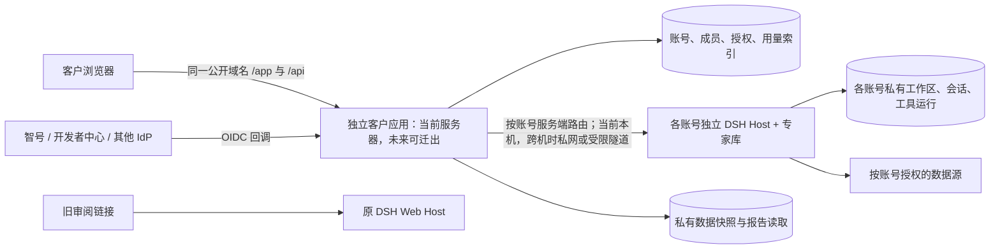

# 专家库客户独立页：分阶段开发与独立部署方案

> 2026-10-08。基于现有独立审阅页、[客户旅程需求 v1.0](ACCOUNT-AND-NEW-SESSION-PRD-20261008.md) 和已确认的用户层 demo。本文是实施方案，尚未表示下述账号、多租户和报告能力已经上线。

**2026-10-08 实施定值：**客户版公开域名为 `https://zhijian.meizu.life`，DNS 指向当前服务器；从 S0 起，DSH 后端地址就是独立的服务端配置 `DSH_BACKEND_URL`，不写死在前端。按下文目标架构建设，应用与 DSH 当前同机、独立进程运行。

**S0 部署选择：**用户指定先指向当前服务器。因此当前独立应用与 DSH 在同一机器、不同进程和不同域名运行，`DSH_BACKEND_URL` 仍由服务端环境指定；以后迁到另一台客户应用服务器只需改变部署和受限后端地址，不改浏览器 API 契约。

**S0 技术闸门更新：**源码核对已证实 DSH Workspace 是工作目录/会话分组，默认沙箱并不限制跨工作区文件读取。外部客户多账号不能只靠单一 DSH 进程内的多个 Workspace 隔离。客户应用保持共享入口，但研究执行改为每个互不信任的客户账号独立 DSH 进程/容器；账号到后端和工作区的映射由 BFF 服务端控制。详见 [S0 状态记录](deployment/customer-portal/S0-STATUS-20261008.md)。

第一阶段实际进度、DNS 与权限闸门见 [S0 状态记录](deployment/customer-portal/S0-STATUS-20261008.md)。
服务端账号与最小会话调用链的实施契约见 [S1 隔离与网关](deployment/customer-portal/S1-ISOLATION-AND-GATEWAY.md)。
公网身份验证试点与当前未开放的研究能力见 [S1 登录发布记录](deployment/customer-portal/S1-AUTH-DEPLOYMENT-20261008.md)。
三个隔离实例的内部首问验收、凭据恢复与研究开放门槛见 [S1 运行实例记录](deployment/customer-portal/S1-RUNTIME-STAGING-20261008.md)。
多账号运行内存复核、单实例隔离边界和按需启停门槛见 [资源与隔离决策](deployment/customer-portal/RESOURCE-ISOLATION-DECISION-20261008.md)。

## 1. 建议结论

**采用“同一代码仓库内的独立客户应用，独立构建和部署”作为第一步。** 新应用单独交付客户前端和 BFF，DSH/专家库实例先继续留在现有服务器；客户浏览器只访问新应用的统一域名，BFF 按账号调用对应的隔离 DSH 实例。现有 `/plugins/dsh-expert-library/review` 审阅页、分享码和运行中研究保持原路径。

这同时解决三件事：客户版可以独立发版和回滚；界面沿用当前协作室的视觉语言；账号、权限和调用链有清楚的服务边界。已验证单 DSH 进程下的 Workspace 不能隔离跨账号文件读取，因此外部客户按账号使用独立 DSH 进程与运行身份；BFF 仍逐层检查会话、文件、工具和数据权限。

暂不建议第一天就另起 Git 仓库：当前插件的 API、报告流程和页面都在变化，同仓可以让契约修改与客户端适配一起评审。应用仍有独立 `package.json`、构建产物、环境配置、发布流水线和部署目标。等共享 API 稳定、团队需要独立权限或发布节奏时，再拆仓不会改变服务架构。

## 2. 以当前界面为底座

| 现有资产 | 复用方式 | 客户版需要调整的部分 |
|---|---|---|
| `assets/review/index.fast.html`、`review.css` | 沿用纸张底色、深绿/陶土配色、顶栏、会话抽屉、工作区内容密度、专家插画和加载态；提取设计变量与可复用组件 | 主视图改为“会话 → 工作区 → 数据”；加账号登录、我的会话、数据清单与表格、客户用量入口 |
| `assets/review/review.js` | 保留已验证的 SSE 重连、状态提示、局部渲染等思路；可抽取与授权无关的纯展示函数 | 当前会话列表写浏览器 `localStorage`，且请求带单会话 `access`，不能整体搬作客户账号应用；改为服务端会话列表和账号认证 |
| `src/host/review-conversation.ts`、`review-presentation.ts`、`review-event-hub.ts` | 优先通过稳定的服务端适配层复用对话投影、研究状态和事件语义 | 新建空白会话、账号归属和跨会话列表需要新增受控入口；不得把现有 scoped grant 扩成全局通行证 |
| `src/host/review-routes.ts`、`review-access.ts` | 保留旧审阅页接口及分享权限，供历史链接继续使用 | 新客户 BFF 另设账号授权入口；不要让浏览器直接调用 DSH 管理接口 |
| 已有计划、大纲、团队进度、报告质量门 | 沿用 DSH/专家库业务内核和用户确认门 | 新增从空白会话进入计划的编排、客户数据选择、私有报告读取和用量归集 |

**代码复用原则：复用视觉资源、纯展示逻辑和稳定业务能力；为客户身份与权限另建适配层。** 不把整份 `review.js` 复制到新项目后长期双轨维护，也不为了“复用”把分享码模型硬套在账号登录上。第一阶段先抽最小共享 UI 资源，具体可抽取边界在真实组件拆分时定，不提前重构整个旧页面。

## 3. 独立项目和部署边界

已启动的目录形态：

```text
dsh-expert-library/
  apps/customer-portal/       # 客户前端 + BFF；独立 package、构建、测试、发布包
  packages/customer-contract/ # 仅在确有共享契约时增加
  assets/review/              # 现有审阅页继续服务历史会话
  src/host/                   # DSH/专家库现有业务能力与新增受控适配接口
```

第一阶段不为目录形态大改根目录构建。`apps/customer-portal` 已建立独立构建与服务端配置，设计变量和插画沿用现有页面；共享包只放两个运行单元真正共用且能稳定版本化的代码。



公开入口推荐让页面、BFF API、SSE 处于同一域名下；例如 `/app/*` 是客户页面、`/api/*` 是新 BFF。这样登录 Cookie、CSRF、SSE 和回调规则可以在一个入口上管理。当前客户应用与 DSH 同机，`DSH_BACKEND_URL` 指向本机受限地址；以后迁出时改为受认证的服务端调用。若页面与 BFF 分别部署，仍通过统一反代维持浏览器同源。现有 `review.js` 使用相对 API、`credentials: same-origin` 和同源 `EventSource`，直接把 `localhost` 改成异域地址不足以完成迁移。

**API 改造量判断：**现有计划、团队、成果和对话投影可以复用，不需要重写研究引擎；但“账号登录、账号下会话列表、空白会话首问、数据结果留存、私有报告、用量与管理员”属于新业务能力，必须有新的受控接口和持久化。初步以 BFF 聚合接口承接这些能力，DSH Host 只补缺失的最小内部能力；接口数量在第一阶段通过调用链验证后锁定，不能先假定只改请求地址。

## 4. 五个开发阶段

各阶段都交付可演示版本；**外部客户正式开放安排在第五阶段验收后**。跨账号权限和用量事件从第一阶段纳入底座，不留到发布前临时补。

| 阶段 | 客户可见增量 | 主要工程交付 | 完成门槛 |
|---|---|---|---|
| **S0 底座与技术闸门** | 基于当前界面的独立空壳，可切换“会话/工作区/数据”；旧页正常运行 | 独立构建/部署样板、最小共用视觉资源、BFF→DSH 受限连接；实测空白 captain 创建/首问、工作区供给、原始 API/文件/工具隔离、私有报告路径和 token 来源 | 两个测试账号互相读不到原始会话/文件；能证明首问调用链；若单实例隔离失败，定下账号独立实例方案再继续 |
| **S1 账号与会话** | 登录页、我的会话、新建空白会话、跨设备找回 | 先接一个生产可验证身份源；账号/用户/身份绑定、账号工作区、会话索引、成员 ACL、幂等创建、会话事件与初始用量采集 | 客户不用旧分享链接，登录后能创建并发送第一问；第二账号无法枚举或打开；重复点击不建重复会话 |
| **S2 对话与数据** | 前期自由沟通；“勾选 + 最后一行自定义”问题卡；`@` 数据源/领域包/专家；第三个“数据” tab 先清单后表格 | 结构化提及目录与权益校验、问答状态、数据查询回执/快照、只读分页表格、材料勾选、来源/版本/许可记录 | `@智见` 等可用对象按真实目录路由；数据可从会话进入清单再进表格，刷新/换设备可恢复；无权限数据不可读 |
| **S3 报告闭环** | 从会话生成方案，选模板/大纲/数据，确认后看团队进展、报告预览、修订、下载 | 复用现有计划/审批/团队/质量门；新增客户编排、任务幂等与恢复、私有成稿网关和版本记录 | 未确认不启动团队；客户独立完成一份含来源的 HTML/PDF 报告；跨账号无法通过直链取得成稿 |
| **S4 管理与对外试点** | 客户查看本账号/会话 token；管理员按账号看用量、额度、状态；完整身份入口按已核实协议上线 | 用量对账、输入/缓存/输出桶、配额拦截和告警、管理员审计；接齐智号/开发者中心等确认的身份源，灰度、备份恢复、故障演练 | 两账号全旅程隔离；用量与 Host/provider 原始事件可对账；额度耗尽不再触发新调用；退出/撤权生效；灰度及回滚演练通过 |

S1 的一个身份源只是首批联调顺序，其他已约定身份源仍在 S4 范围内；S2 的三类 `@` 都保留在目标体验里，实际可用项由客户权益和源目录决定。S3 的内部演示不等于可对外开放，S4 的额度、审计和运维门槛仍需通过。

### 每阶段怎么验收

- 每阶段固定保留一条原审阅页回归路径，避免新客户版改动影响已有分享链接、运行中会话和报告审批。
- 演示数据与真实数据分开标记。S0 可用模拟内容核对视觉；S1 以后会话/数据/报告状态必须来自真实服务端，不用前端假状态冒充完成。
- 客户侧至少用两个账号、两台或两个隔离浏览器验证；同时直接请求 API、SSE、文件下载和工具引用，不能只看页面是否隐藏。
- 发布按“独立前端/BFF → 内部联调 → 小范围客户灰度 → 扩大开放”推进；每阶段有自己的构建产物与回滚点。

## 5. 第一阶段的具体待办

1. 固定当前演示页的视觉基线：顶栏、会话抽屉、三主视图、问题卡、数据清单/表格、报告预览；保持当前协作室色彩和插画。
2. 建立 `apps/customer-portal` 的独立构建与本地预览，接口用可替换的 BFF adapter；把设计变量和必要资源从当前页面提取为共享输入，而非整页复制。
3. 对现有 DSH 做六项最小调用链验证：工作区供给、空白 captain、首问、会话/事件读取、文件/工具隔离、模型用量原始记录。每项记明已有入口、需补的最小入口和权限主体。
4. 给客户 BFF 定服务契约：`user_id → account_id → workspace_id → captain_session_id` 的服务端映射；创建、读取、SSE、下载均复核归属。身份回调与服务端凭据不进入浏览器。
5. 做一张“双账号交叉访问”验收表，并验证同源反代、Cookie、SSE 断线恢复和旧审阅页共存。只有技术闸门通过后，S1 才接真实客户身份。

## 6. 需要产品侧最终定值但不阻挡 S0 的项目

首批客户/议题、最先联调的身份源及其生产协议、首批数据源与报告模板、初始 token/查询/并发额度、是否开放自助注册。这些值可以在 S0 验证过程中补齐；账号归属、私有文件和跨账号隔离方案不依赖这些业务定值。
