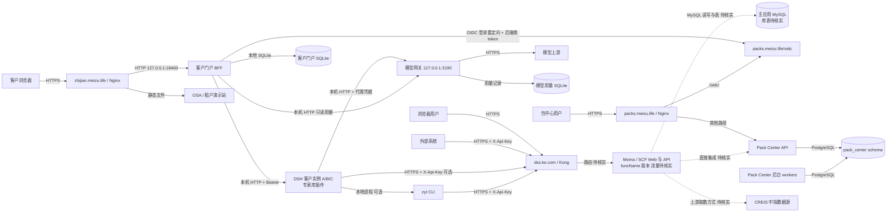
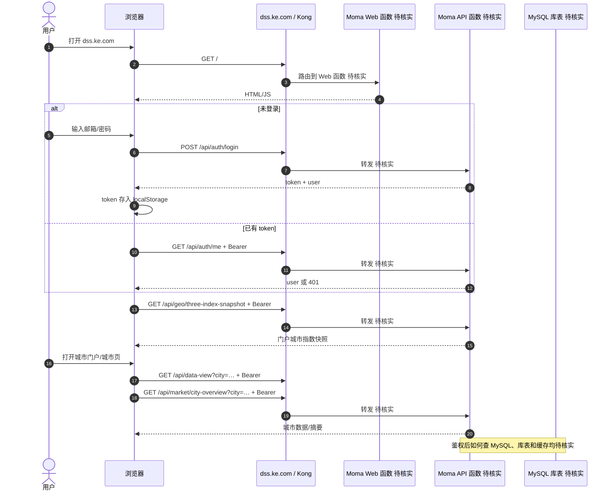
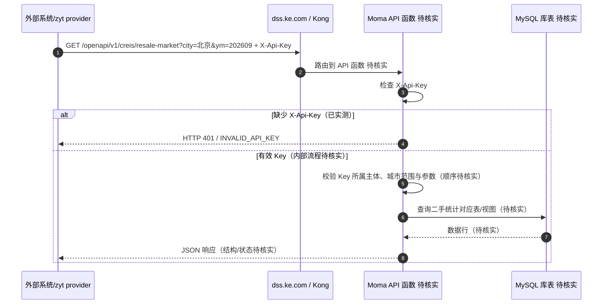

# 智见系统生产部署与调用拓扑（核实版）

核对时间：2026-10-27（Asia/Singapore）。本文把 `dss.ke.com` 的 Moma/SCF 应用，与本机 Nginx 承载的 `zhijian.meizu.life` 客户门户、`packs.meizu.life` 包中心分别记录。**它们共享“智见”业务名称，但现有证据不能证明它们是同一部署或共用数据库。**

## 0. 证据边界与结论

- **已核实**：公开响应、当前机器的 Nginx/systemd 配置、仓库源码与 Git 引用、已部署 CLI 的 `SOURCE_COMMIT`。`dss.ke.com` 的 HTTP 响应含 Kong/SCF 头；`zhijian.meizu.life` 和 `packs.meizu.life` 由本机 Nginx 分流至独立进程。
- **用户提供，待平台复核**：Moma 生产 serviceId=`btg-serverless`、测试 serviceId=`gpt-api`；每个应用独立 funcName、版本与流量配比。本机的预览发布工具也包含这一 serviceId 映射，但没有证明 `dss.ke.com` 当前属于哪个 funcName、版本或流量配置。
- **没有证据**：`dss.ke.com` 主应用服务端代码仓库、生产分支/commit、MySQL 库表和迁移路径、域名→函数绑定、登录/API 是否同一函数、主应用与 Pack Center 的直接集成。下文统一写“待核实”。
- [现有部署页](https://zhijian.meizu.life/osa/deployment.html) 可访问，页面注明 2026-10-15；其主体是 OSA/租户演示站、Pack Center 和客户 `/app` 的代码地图，**不能当作 `dss.ke.com` 的 Moma 发布清单**。

## 1. 服务清单

| 服务/部署点 | 生产入口与用途 | 仓库路径、分支/版本证据 | 构建/启动入口 | 尚待核实 |
|---|---|---|---|---|
| 智见主应用 Web/API（Moma/SCF） | `https://dss.ke.com/`，首页、登录、城市门户、`/api/*`；同域 `/openapi/v1/*` 对外取数。公开响应为 Express，经 Kong/SCF。 | **主应用服务端仓库、生产分支与 commit 均待核实**；公开网页仅能证明前端请求形态。 | `funcName`、真实 `build-server.sh`、`scf_bootstrap`、发布脚本均待核实。 | Web/API 是一个还是多个函数；域名、路由、版本、流量配比；MySQL 连接。 |
| 智见客户门户 BFF | `https://zhijian.meizu.life/app` 及 `/api/*`；本机 Nginx → `127.0.0.1:18460` → `zhijian-customer-portal.service`，服务进程为 `/opt/zhijian/customer-portal/server.mjs`。 | `dsh-expert-library/apps/customer-portal/`；本机源码 `main@c935b8e`，**运行制品的精确源码 commit 待核实**。 | 源码 `apps/customer-portal/server.mjs`；systemd 以 `/opt/zhijian/customer-portal/node …/server.mjs` 启动。 | 该服务非 Moma；当前部署制品 SHA 与发布记录。 |
| DSH 客户实例 A/B/C、专家库插件 | BFF 内网调用 `127.0.0.1:3191/3192/3193`；DSH 运行 `dsh-expert-library` 插件，调用 zyt provider。无公开域名。 | `dsh-expert-library/src/host/`、`src/v2/providers/zyt.ts`；源码 `main@c935b8e`，实例装载版本待核实。 | systemd `zhijian-dsh-demo-{a,b,c}.service`，`/usr/lib/node_modules/@deepseek-ai/dsh/lib/bin.js --profile pilot`；插件从 `/opt/zhijian/customer-dsh-runtime…` 加载。 | 各实例运行制品 hash、插件版本/配置与账号映射。 |
| zyt CLI（专家库可选传输） | 本机 `/opt/zhijian/customer-zyt-cli/zyt`；通过 HTTPS 调 `dss.ke.com/openapi/v1/*`。无独立域名/函数。 | `zhijian-cli-public`：部署标记 `SOURCE_COMMIT=d0a47b9ec6be037e79f0bcd905a8242d57a8f12b`，提交在 `yanjiuyuan.query.data`。 | Python CLI 包装入口 `/opt/zhijian/customer-zyt-cli/zyt`；具体发布流水线待核实。 | 哪些客户实例选 CLI、哪些选 HTTP，需核对实时账号配置；C 实例已有 CLI 取数回执。 |
| Pack Center API | `https://packs.meizu.life/`；Nginx → `127.0.0.1:18440` → `pack-center-api.service`。包、版本、发布、治理 API。 | `pack-center/apps/pack-center/`；本机仓库 `main@505cde5`，运行的 `dist/` 精确 commit 待核实。 | `node dist/main.js api`；迁移见第 5 节。 | 发布制品 hash、后台 worker 版本。 |
| Pack Center OIDC | `https://packs.meizu.life/oidc/`；Nginx → `127.0.0.1:18450` → `pack-center-oidc.service`。客户 `/app` 的登录身份源。 | `pack-center/oidc/service.mjs`；本机仓库 `main@505cde5`，运行代码精确 commit 待核实。 | systemd 直接启动 `oidc/service.mjs`。 | 与 `dss.ke.com` 是否也对接：待核实；当前 `dss.ke.com` 前端呈现独立邮箱/密码登录。 |
| Pack Center 后台 worker | 无公开域名；`pack-center-workers.service` 执行校验任务，`pack-center-publish.service` 执行发布/签名任务，均为 active。 | `pack-center/apps/pack-center/`；本机 `main@505cde5`，运行 `dist/` 精确 commit 待核实。 | `node dist/main.js validate-worker`、`node dist/main.js publish-worker`。 | 任务队列、发布制品与数据库的实时状态需核对后台日志。 |
| 智见模型网关 | 无公开域名；仅监听 `127.0.0.1:3190`，接收 DSH 客户实例的模型请求并转发上游；BFF 可读取内部用量。 | `dsh-expert-library/apps/model-gateway/`；本机 `main@c935b8e`，运行制品 commit 待核实。 | `zhijian-model-gateway.service` 启动 `/opt/zhijian/model-gateway/server.mjs`。 | 实例到网关及网关上游的账号配置/模型版本应按私有配置核实。 |
| OSA/租户演示静态站 | `https://zhijian.meizu.life/osa/`、`/tenant-studio/`；Nginx 直接映射 `/var/www/cagent/`。 | `zhijian-retail-agent-demo` 本机路径 `/root/zhijian/deliverables/Gz/cagent/`，checkout `main@8a6d56b`；已发布文件对应 commit 待核实。 | `cagent/src/build.py` → `dist/`，再发布到 `/var/www/cagent/`。 | `/tenant-studio/mcp` 指向 `127.0.0.1:18765`，检查时 `osa-tenant-products-mcp.service` 为 inactive，公网请求返回 502；需核实是否仍应提供该演示接口。 |

补充仓库：`zhijianharness`（本机 `/root/zhijian/zhijianharness-main`，`main@51f91d3`）是 DSH 相关配置/部署仓库；`dsh-pack-zhijian-realestate`（`main@695f621`）和 `dsh-pack-zhijian-residential-advisory`（`main@82fe361`）是领域包源码。它们不构成 `dss.ke.com` 主应用服务端仓库的证据。

### Moma 发布工具的适用范围

本机 `/root/zhijian/yy-moma-deployment-plan-20261004/` 提供 `moma_deploy.js`、`moma_build.sh`、`scf_bootstrap`。其中 `moma_deploy.js` 在 `prod` 选择 `btg-serverless`、非 `prod` 选择 `gpt-api`；`scf_bootstrap` 启动的是静态 `server.js`。该工具包的 README 明确说明这是**静态 Preview 工具**、未执行真实发布、完整 DSH Host 未装入。不能把它列为 `dss.ke.com` 当前部署脚本。当前搜到的仓库与 `/opt/zhijian` 未找到主应用的 `build-server.sh`。

## 2. 仓库、生产分支与最近关键变更

| 仓库 | 作用 | 当前可证实的引用 | 生产分支判断 |
|---|---|---|---|
| `zhijian-cli-public` | zyt CLI/OpenAPI 命令，含中指和城市专报命令 | `yanjiuyuan.query.data@d0a47b9`；前一提交 `94bd266` 加城市月报；远端 `release@8d65e36`、本机 `main@d5a4c0a` | CLI 已部署 commit 为 `d0a47b9`；**不能据此称该分支已合并进 main/release**。 |
| `dsh-expert-library` | Provider 抽象、zyt HTTP/CLI 适配、客户门户 BFF | 本机和 `origin/main@c935b8e`；`zyt.ts` 已声明 4 个城市专报、5 个 CREIS 中指操作 | 仓库 checkout 是 main；线上插件与 BFF 制品的 commit 待核实。 |
| `pack-center` | 包中心、OIDC、PostgreSQL 数据层 | 本机 `main@505cde5` | 仓库 checkout 是 main；服务当前 `dist/` 的构建 commit 待核实。 |
| `zhijian-retail-agent-demo` | OSA/租户演示静态前端 | 本机 `main@8a6d56b` | 静态已发布文件的构建 commit 待核实。 |
| `zhijianharness`、两个 `dsh-pack-*` | DSH 配置与领域包 | 上节列出本机 main HEAD | 是否由当前生产实例加载、具体发布版本待核实。 |
| `dss.ke.com` 主应用 | Web、`/api/*`、`/openapi/v1/*` 服务端 | 仓库路径待核实 | 生产分支、`yanjiuyuan.query.data` 是否曾合入主应用、发布 commit 均待核实。 |

## 3. 服务交互与认证

| 调用方向 | 协议/入口 | 认证与当前证据 |
|---|---|
| 浏览器 → `dss.ke.com` → Kong/SCF | HTTPS；首页 `/`，同域 `/api/auth/login`、`/api/auth/me`、`/api/data-view`、`/api/geo/three-index-snapshot`、`/api/market/city-overview` | 首页脚本显示邮箱/密码 POST 登录，取得 `token` 后写入浏览器 `localStorage` 的 `zyt_token2`，其后 `/api/*` 使用 `Authorization: Bearer`。网关→具体函数路由待核实。 |
| 外部系统/zyt provider → `dss.ke.com` OpenAPI | HTTPS `/openapi/v1/*`，例如 `/openapi/v1/creis/resale-market?city=…&ym=YYYYMM` | `X-Api-Key`；无此头实测 HTTP 401、`INVALID_API_KEY`。授权 key 与城市权限的实现/顺序待核实。 |
| `zhijian.meizu.life` BFF ↔ Pack Center OIDC | 浏览器重定向与后端 HTTPS；`packs.meizu.life/oidc` → `/app` 的 `/api/auth/callback` | OIDC Authorization Code + PKCE S256；Pack Center 发 RS256 ID token；BFF 验证后建立 `__Host-zhijian-session` Cookie。**这是客户 `/app` 的登录链路，不能套用到 `dss.ke.com`。** |
| 客户 `/app` BFF → DSH 客户实例 | 仅本机 HTTP，`/plugins/dsh-expert-library/customer-gateway/*` | BFF 从受保护的实例 token 文件读取密钥并附 `Authorization: Bearer`；浏览器不能提供后端 origin/服务凭据。 |
| DSH 专家库 → zyt CLI 或 HTTP → `dss.ke.com` | CLI 本地进程或 HTTPS `/openapi/v1/*` | `zyt.ts` 绑定 `http-api` 或 `local-cli`；HTTP 由 provider service 注入 `X-Api-Key`，CLI 从私有凭据配置取 key。`preferCli` 取决于实例/账号配置。 |
| Pack Center API → PostgreSQL | PostgreSQL 协议 | 库连接来自受保护环境配置；代码要求 PostgreSQL URL，默认 schema `pack_center`。 |
| Pack Center 后台 worker → PostgreSQL | PostgreSQL 协议 | 校验、发布任务由独立 systemd worker 进程执行；任务状态及表级写入需以源码/日志核对。 |
| 客户 `/app` BFF → 本地 SQLite | Node `node:sqlite` | 账号、身份、浏览器会话与研究会话状态；建表逻辑在 `apps/customer-portal/account-store.mjs`。 |
| DSH 客户实例 → 模型网关 → 模型上游 | 本机 HTTP → 外部 HTTPS | DSH 以每账号代理凭据访问 `127.0.0.1:3190`；网关保管上游凭据并记录用量。BFF 可使用独立只读凭据读取 `/internal/usage`。 |
| `dss.ke.com` 主应用 ↔ MySQL | **待核实** | MySQL 为本次需求提供的架构背景；服务器端代码、连接、读写表、权限/迁移均未取得。 |
| `dss.ke.com` 主应用 ↔ Pack Center | **待核实** | 仅证实独立客户 `/app` 与 Pack Center 的 OIDC 对接；未见 dss 主应用对 Pack Center 的调用证据。 |
| `dss.ke.com` 主应用 ↔ CREIS 上游 | **待核实** | 已证实对外 CREIS OpenAPI 路径；上游数据是实时请求、定时同步、文件导入还是查本地 MySQL，需从主应用源码/作业/库表核实。 |

实线为源码/当前配置/公开响应支持的方向；虚线仅表示需求中的待核实关系，不代表已存在调用。

## 4. 请求链路（端到端）

### 4.1 登录后访问 `dss.ke.com` 首页和城市门户

公开首页 JS 证明浏览器请求和 token 用法，服务端内部具体函数及 MySQL 访问尚待核实。`/api/data-view` 用于特定城市的派生数据；门户卡片使用 `/api/geo/three-index-snapshot`，进入城市监测时还会请求地理树、范围数据和 `/api/market/city-overview`。前端注释声称指数快照按权限城市过滤，**服务端是否强制授权必须核实**。

图中 Web/API 分成两个逻辑角色，**不表示已经证实是两个 funcName**。已有 token 时会先调 `/api/auth/me`；新登录成功后前端直接取得 `user`，无需把 `/api/auth/me` 当成每次登录的必经步骤。

### 4.2 外部 OpenAPI 调 CREIS 二手统计

已实测的是**缺少** `X-Api-Key` 返回 401；城市权限校验、CREIS 数据在 MySQL 的表名与查询顺序、有效 Key 的生产回包，均不能仅凭客户端适配器确认。对已授权账号的最小只读请求及发布日志/服务端源码可完成补证。

## 5. 数据存储与迁移归属

| 存储 | 所属服务与读写者 | 已证实的表/文件 | 迁移位置 |
|---|---|---|---|
| 主应用 MySQL（**待核实**） | `dss.ke.com` 主应用：哪些函数读写、CREIS 是实时查还是同步入库均待核实 | 数据库名、schema、用户/城市授权表、城市指标表、CREIS 表/视图、作业表均待核实 | 主应用仓库/迁移脚本位置待核实；不能用 Pack Center 的 SQL 代替。 |
| Pack Center PostgreSQL | `pack-center-api` 读写；默认 schema `pack_center` | `organizations`、`users`、`memberships`、`sessions`、`packages`、`submissions`、`releases`、`deployments`、`jobs`、`audit_events`、`download_grants`、`user_api_tokens`、`source_uploads` 等 | `pack-center/apps/pack-center/migrations/001_core.sql` 至 `018_source_uploads_and_safety.sql`；`src/database.ts` 用 `schema_migrations` 校验并要求显式应用。 |
| 客户 `/app` SQLite | `zhijian-customer-portal` BFF 读写 | `accounts`、`users`、`identities`、`memberships`、`browser_sessions`、`research_sessions`、`session_tasks`、`session_groups`、`session_preferences`、`session_share_links` | `dsh-expert-library/apps/customer-portal/account-store.mjs` 内建表/升级逻辑；实际数据库位置由私有配置指定。 |
| 模型网关 SQLite | `zhijian-model-gateway` 读写 | `model_calls` 用量/状态记录；客户 `/app` 可经内部只读接口查询 | `dsh-expert-library/apps/model-gateway/server.mjs` 中 `UsageLedger` 建表逻辑；实际数据库位置由私有配置指定。 |
| DSH 客户实例本地状态 | 每个 `zhijian-dsh-demo-*` 实例及插件读写会话、数据集、包库存 | 具体持久化文件/表随 DSH 版本和实例配置；本次未枚举完整 schema | 需从实例配置与 DSH 发布制品核实；不应归入主应用 MySQL。 |
| Pack Center OIDC 私有文件 | `pack-center-oidc` 读取用户凭据与签名材料 | 仅记录用途；不记录明文凭据或密钥 | 非数据库迁移，文件生命周期/轮换由运维配置决定。 |

## 6. 需去 Moma/发布日志/主应用仓库核实的清单

1. **Moma 应用和路由**：生产 `btg-serverless` 中服务清单，`dss.ke.com` 的域名/路径→`funcName` 映射；Web、`/api/*`、`/openapi/v1/*` 是否共用函数；测试 `gpt-api` 对应关系。
2. **当前有效发布**：每个 funcName 的版本、别名、流量配比、构建物 SHA/发布单号、回滚点；从发布记录反查 Git 仓库、分支、commit、构建脚本、`scf_bootstrap`。
3. **主应用服务端源码**：`/api/auth/login`、`/api/auth/me`、城市门户接口、OpenAPI API Key 中间件、城市范围鉴权、CREIS 路由与错误码；确认校验顺序和是否有缓存。
4. **MySQL**：实例/库/schema、迁移工具与目录、关键表/视图、函数读写权限、备份/恢复；CREIS 原始数据的采集作业、更新频率、来源追溯和城市范围字段。
5. **Pack Center 集成**：`dss.ke.com` 是否配置 OIDC/包拉取/API 直连；若有，提供应用 clientId、重定向 URI、服务间调用日志与权限范围。**不要提供密钥明文**。
6. **安全与运维**：API Key/数据库密码的凭据标签、存储机制及轮换负责人；Kong/SCF 日志关联 ID、告警、访问白名单、跨域、限流和重试策略；不要在文档或仓库写入密钥。
7. **本机非 Moma 服务**：客户 BFF、DSH 插件、Pack Center 的构建制品与源码 commit 对照；确认 OSA MCP 是否应运行，并修正页面上的旧状态。

## 7. 核查来源

- 公开：[`/osa/deployment.html`](https://zhijian.meizu.life/osa/deployment.html)（HTTP 200；页面日期 2026-10-15）；`https://dss.ke.com/`（HTTP 200，Kong/SCF 响应头及前端 JS）；无 Key 请求 `https://dss.ke.com/openapi/v1/creis/resale-market`（HTTP 401 / `INVALID_API_KEY`，2026-10-27）。
- 本机路由与进程：`/etc/nginx/conf.d/zhijian.meizu.life.conf`、`/etc/nginx/conf.d/packs.meizu.life.conf`；上述 systemd 单元的 `ExecStart`/`ActiveState`。
- 源码：`dsh-expert-library/apps/customer-portal/{server.mjs,oidc-client.mjs,dsh-gateway.mjs,account-store.mjs}`、`src/v2/providers/zyt.ts`、`src/host/provider-service.ts`；`pack-center/{oidc/service.mjs,apps/pack-center/src/{config.ts,database.ts},apps/pack-center/migrations/}`；`yy-moma-deployment-plan-20261004/{README.md,moma_deploy.js,scf_bootstrap}`；`zhijian-cli-public` Git 引用与 `/opt/zhijian/customer-zyt-cli/SOURCE_COMMIT`。
